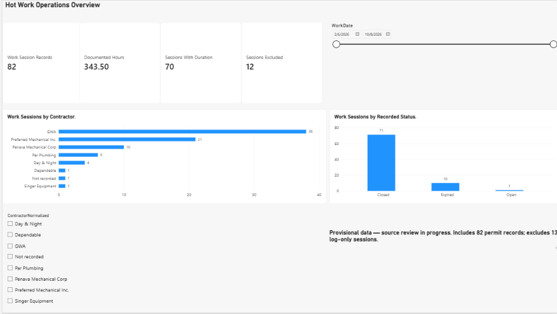
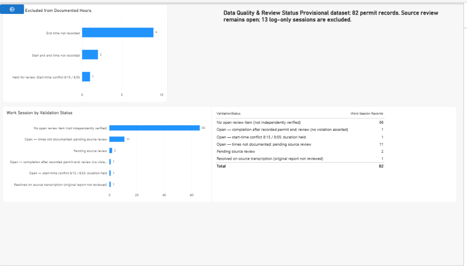

# Hot Work Operations Analytics

**Starky Paulino | Excel · Power Query · Power BI · DAX**

> Provisional analysis. Source review is ongoing, and totals may change.

## Project goal

Turn hot work records into an interactive view of contractor activity,
recorded statuses, documented hours and data quality.

My Fire Life Safety Director experience informed the distinction between
permit identifiers, individual work sessions and documented completion times.

## Dashboard overview

- 82 work session records
- 343.50 documented hours across 70 records
- 12 records excluded from duration calculations
- Recorded statuses: 71 Closed, 10 Expired and 1 Open
- Largest contractor group: 38 records, or 46.3% of the total

These are record counts, not distinct permit counts. A permit number
can cover more than one work session. Recorded statuses do not independently
establish current operating conditions or compliance.

## Data preparation

- Prepared an Excel table with one row per work session record.
- Assigned fixed WorkSessionIDs rather than using permit numbers as keys.
- Preserved original company names and mapped confirmed spelling variants
  to normalized contractor names.
- Kept recorded permit end times separate from actual work completion.
- Preserved missing times as blanks.
- Excluded missing or disputed durations from documented-hours metrics.
- Maintained correction history, evidence references and review flags.
- Imported tblPBIWorkSessions through Power Query and assigned data types.

## Power BI report

### Overview

Four KPI cards, contractor and recorded-status charts, and contractor
and work-date slicers.

### Data Quality

Duration exclusions and validation statuses remain visible alongside
the operational results.

The 12 duration exclusions comprise:

- 9 records without an end time
- 2 records without a start or end time
- 1 record held for a start-time conflict

“No open review item” does not mean independently verified.

## DAX measures

~~~DAX
Work Session Records =
COUNTROWS('tblPBIWorkSessions')

Documented Hours =
SUM('tblPBIWorkSessions'[DocumentedDurationHrs])

Sessions With Duration =
CALCULATE(
    COUNTROWS('tblPBIWorkSessions'),
    'tblPBIWorkSessions'[DurationEligibility] = "Included"
)

Sessions Excluded =
[Work Session Records] - [Sessions With Duration]
~~~

## Validation performed

- Compared Power BI totals with the prepared Excel table.
- Tested contractor and date slicers and restored the full dataset view.
- Refreshed the Excel import and checked that report totals remained
  82 records, 343.50 hours, 70 included and 12 excluded.
- Checked that contractor totals and recorded-status totals each sum to 82.

These checks establish consistency within the prepared dataset;
they do not complete original-source validation.

## Reconciliation and limitations

The separate Hot Work Log contains 94 sessions:

- 81 match database records
- 13 are log-only and are excluded from this Power BI dataset
- 1 database record has no matching log session

All records are marked Provisional. Fifteen reconciliation review items
remain pending, alongside additional review flags and a certificate
identity conflict.

Three records were corrected using a workbook source transcription.
The original reports were not reviewed for those corrections.

Documented hours exclude incomplete or disputed durations and do not
represent total hot work hours. This report is an analytical prototype,
not a compliance determination.

## Refresh and maintenance

Save the source Excel workbook before refreshing Power BI.
New source records currently require a fixed WorkSessionID and a
corresponding row in the Power BI input table.

## Repository contents

This repository presents summary screenshots and project documentation.
Source reports, row-level records, the Excel workbook and the Power BI
file are not included.

## Next steps

- Review outstanding source evidence.
- Resolve time, identity and possible-duplicate conflicts.
- Update the analysis and screenshots as validated records change.
